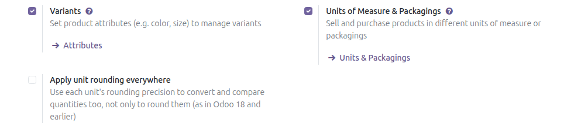
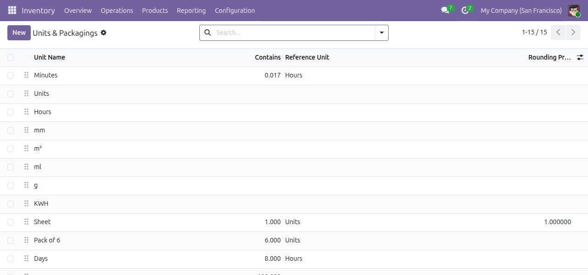
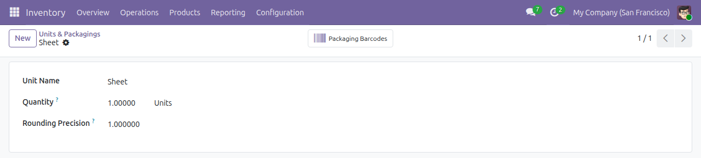
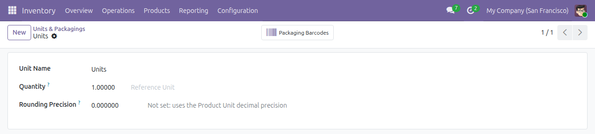

**1. Show units of measure**

Go to **Inventory > Configuration > Settings** and, under *Products*, enable
**Units of Measure & Packagings**. Click **Save**.

The module's setting, **Apply unit rounding everywhere**, appears below it. Leave it
unchecked for now (see step 4).

**2. Clean up fractional quantities first**

Once a unit has a precision of `1`, Odoo refuses to validate a quantity that isn't a
whole number in that unit (*"The quantity done ... doesn't respect the rounding
precision defined on the unit of measure"*), as Odoo 18 did. That includes the
inventory adjustment that would remove leftover fractions. So, before setting the
precision on a unit:

- Find stock with fractional quantities in that unit (**Inventory > Reporting >
  Stock**, grouped by product) and correct it with an inventory adjustment, e.g.
  20.4 sheets to 20 or 21.
- Open transfers and manufacturing orders that already have fractional quantities
  keep them. When they are validated, Odoo asks for a whole quantity: enter the
  quantity actually picked or used (e.g. 21). Or update them beforehand.

Found more later? Clear the unit's precision, apply the adjustment, then set the
precision again.

**3. Set a unit's rounding precision**

Go to **Inventory > Configuration > Units & Packagings**. The **Rounding Precision**
column shows the units that have one; a blank cell means the unit uses the *Product
Unit* decimal precision, as in standard Odoo.

Open the unit, e.g. *Sheet*, and enter its **Rounding Precision**:

- `1`: whole units only (sheets, pieces, boxes).
- `0.5`: halves; `0.01`: hundredths.
- Empty or `0`: no precision of its own (standard Odoo).

The value must be a multiple of the *Product Unit* decimal precision (`0.01` with 2
decimals, `0.000001` with 6), because quantities are not stored with more decimals
than that.

A unit without its own precision says so:

The value takes effect immediately for every quantity Odoo computes from then on.

**4. Choose how far the precision reaches (optional)**

In **Inventory > Configuration > Settings**, **Apply unit rounding everywhere**:

- **Off** (recommended): Odoo rounds the quantities it computes in the unit (see the
  table in the description), but converts and compares quantities with the *Product
  Unit* precision, as in standard Odoo 19.
- **On**: the unit's precision is also used to convert quantities between units and
  to compare them, as in Odoo 18 and earlier. For example, converting 0.25 *Box of 10*
  into a unit rounded to `1` gives 3 instead of 2.5, and 0.4 of a unit rounded to `1`
  counts as zero, so leftover fractional stock (step 2) is ignored instead of shown.
