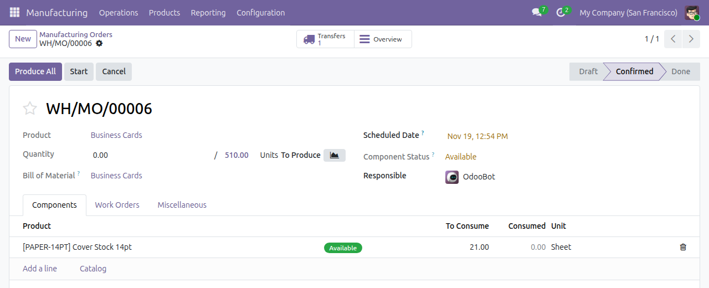

Give a unit of measure its own rounding precision again, for example to always
consume, pick and move **whole** sheets, boxes or pieces.

Up to Odoo 18, every unit of measure had a *Rounding Precision*. Odoo 19 removed it:
all units now share the decimal precision named *Product Unit* (Settings > Technical >
Decimal Accuracy). With that precision at 2 or more decimals, a bill of materials
that uses 0.04 sheet per card asks for **20.4 sheets** to make 510 cards, and the
*Pick Components* transfer asks for 20.4 sheets too. In Odoo 18, with the Sheet unit
rounded to 1, it asked for **21**.

This module adds an optional **Rounding Precision** to each unit of measure:

- **Empty** (the default): the unit behaves exactly as in standard Odoo 19.
  Installing the module changes nothing until you set a value.
- **Set**, e.g. to `1`: the unit gets Odoo 18's rounding back. Manufacturing orders
  round their components **up** to it, so the example above asks for 21 sheets on the
  manufacturing order and on its *Pick Components* transfer.

A setting, **Apply unit rounding everywhere**, decides how far the unit's precision
reaches. Whichever you choose, it only affects units that have a precision.

| A unit with a precision of `1` | Off (default) | On (all of Odoo 18) |
|---|---|---|
| Quantities Odoo computes are rounded to it: components to consume, quantity changes on manufacturing orders, on-hand and forecasted quantities, quantities to reorder | Yes | Yes |
| A done quantity must be a multiple of it (20.4 sheets can't be validated) | Yes | Yes |
| Converting between units rounds to it (0.25 *Box of 10* = 3, not 2.5) | No | Yes |
| Comparisons use it (0.4 sheet counts as zero) | No | Yes |

Leave the setting off unless you need Odoo 18's behaviour in full.

