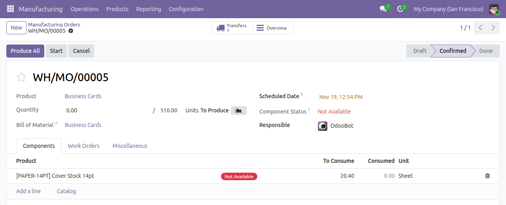
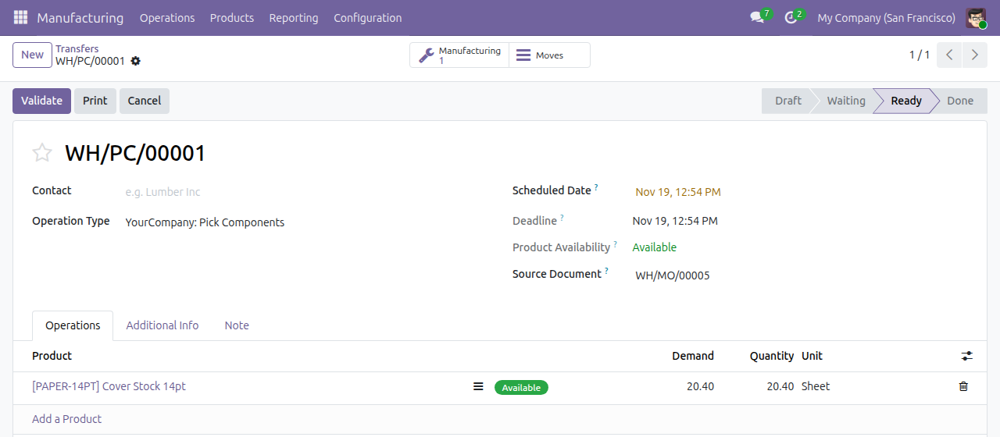
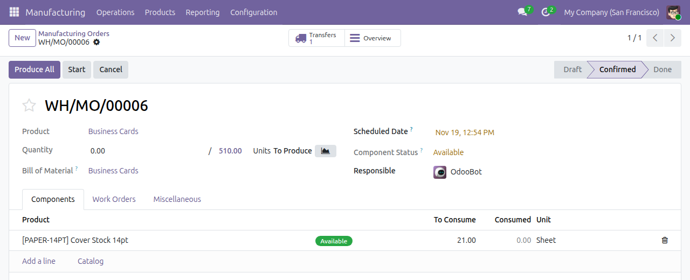
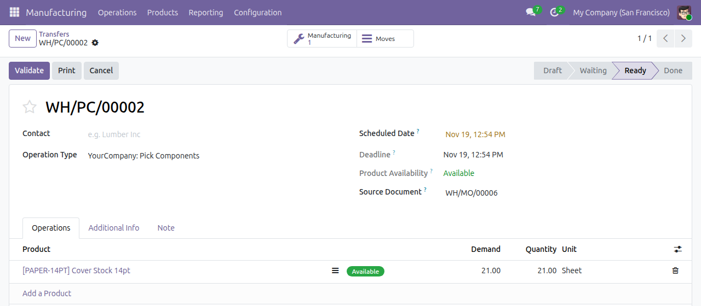

Example: business cards printed 25 per sheet, so the bill of materials of one card
uses 0.04 *Sheet* of paper.

**Without a rounding precision on Sheet** (standard Odoo 19), a manufacturing
order for 510 cards needs 20.4 sheets:

and, with *Pick components then manufacture* in the warehouse, the *Pick Components*
transfer moves 20.4 sheets:

**With Sheet rounded to 1**, the same order needs 21 sheets, rounded up because a
partial sheet still has to be picked and used:

Nothing else changes in the way you work: create and process manufacturing orders,
transfers and sales as usual.

Tip: a bill of materials whose quantity is a rounded fraction (e.g. 0.866667 for
13/15) can exceed a whole number by a tiny amount (120 x 0.866667 = 104.00004), which
rounds up to one more unit (105). Express such a bill of materials for a larger
quantity instead (13 sheets for 15 units), so the quantity is exact.
